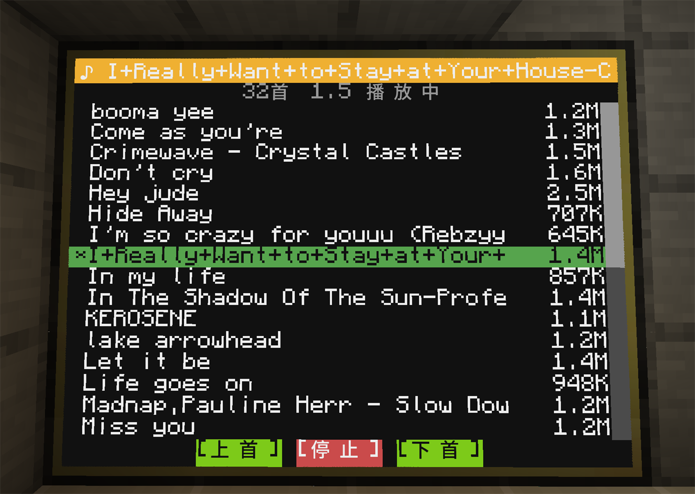

# 🎵 CC Music Player 🎵

Background music for your CC: Tweaked computers — pick songs on a monitor, autoplay a
playlist, turn the volume up and down.

*[中文说明](README.md) · **English***



## How do I download?

  1. Click **Releases** on the right and grab `music.lua` and `startup.lua`
  2. Need to convert songs? Also grab `Converter.zip` (unzip it, then drag a folder
     onto `convert.bat`)

## How do I install?

  1. Make sure **CC: Tweaked 1.100 or newer** is installed (it needs the
     `cc.audio.dfpwm` module)
  2. **Required for Chinese text:** [**CC UTF-8 Compat**](https://github.com/Kondrashka177/CC-UTF8-Compat)
     — CC's built-in font only has 256 glyphs, so CJK turns into `?` / garbage without it.
     English-only users can skip it and set `lang = "en"`
  3. Drop `music.lua` and `startup.lua` into
     `saves/<world>/computercraft/computer/<id>/`
  4. Run `reboot` on the computer in-game, or rejoin the world

You can also download from inside the computer (the HTTP API must be enabled):

```
wget https://raw.githubusercontent.com/737max6/cc-music-player/main/music.lua music.lua
wget https://raw.githubusercontent.com/737max6/cc-music-player/main/startup.lua startup.lua
wget https://cdn.jsdelivr.net/gh/737max6/cc-music-player@main/music.lua music.lua
wget https://cdn.jsdelivr.net/gh/737max6/cc-music-player@main/startup.lua startup.lua
```

## How do I add music?

A CC computer **cannot** decode mp3 — it only speaks **DFPWM**, so convert first.

  1. Install **ffmpeg** and **Node.js** on your PC
  2. **Windows**: drag your music folder onto `tools\convert.bat`
     **macOS / Linux**: `node tools/convert.js /path/to/music`
  3. Copy the resulting `.dfpwm` files into the computer's `music/` folder
  4. Press `r` in-game to rescan

The converter drops cover art, normalises everything to 48 kHz mono, and skips files
that are already up to date (`--force` redoes them).

## How do I use it?

**Keyboard**

  * `↑` `↓` select a song, `Enter` play / stop
  * `Space` stop, `←` `→` previous / next
  * `+` `-` volume, `r` rescan

**Touch screen**

  * Tap a song to play it, tap again to stop
  * Bottom row `[Prev] [Stop] [Next]`
  * The right-hand column is a scrollbar — tap anywhere on it to jump

## Config

Open the `CONFIG` table at the top of `music.lua`:

  * `lang` — `"zh"` Chinese UI / `"en"` English UI
  * `title` — what the header shows when playback is stopped
  * `monitorName` — monitor peripheral name; `nil` = first monitor found
  * `autoplay` / `loopPlaylist` / `shuffle` — play on boot, loop, shuffle
  * `volume` — initial volume, `0` – `3`

## FAQ

**Q: No sound?**

  1. Is a speaker attached? `peripherals` should list `speaker`
  2. Does the bottom-left of the screen say "no speaker"?
  3. Is the volume `0`?

**Q: My songs don't show up?**

Only audio file extensions are listed. Unconverted files are dimmed and tagged `(cvt)`.

**Q: Why does it sound like an old radio?**

DFPWM is **1-bit** audio — that's what CC speakers speak. Normalising loudness before
converting helps a lot.

**Q: Will a few hundred songs lag?**

No. Playback is streamed: 16 KB (~2.7 s) at a time, paced by the `speaker_audio_empty`
event, with a 0.5 s heartbeat as a safety net.

**Q: Can file names be non-ASCII?**

Better not — stick to ASCII. On some setups CC's filesystem turns Japanese / Russian
names into `?`, and then the player can't open the file. For pretty names use
`music/names.txt`:

```
song_01=Одна (АДЛИН)
song_02=夜に駆ける
```

## Credits

  * [CC: Tweaked](https://github.com/cc-tweaked/CC-Tweaked) — speakers and `cc.audio.dfpwm`
  * [CC UTF-8 Compat](https://github.com/Kondrashka177/CC-UTF8-Compat) — UTF-8 terminals

## License

MIT, except `tools/dfpwm-encode.js`, which is ported from CC: Tweaked and therefore
licensed **MPL-2.0**.

## AI

Script written by DeepSeek.
