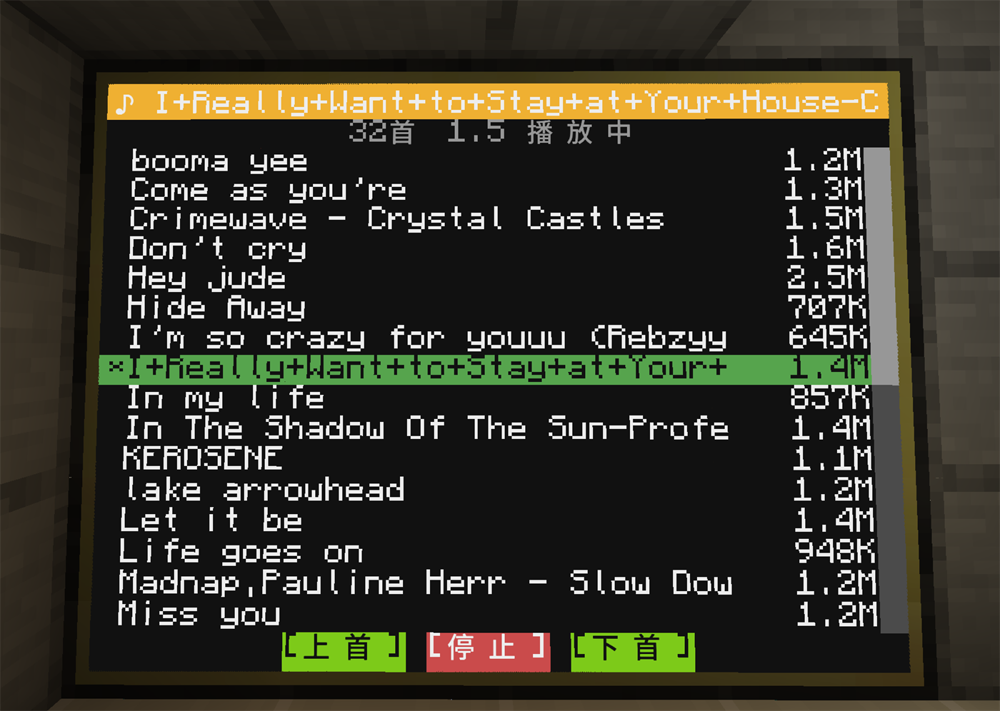

# 🎵 CC 音乐播放器 🎵

在 CC: Tweaked 电脑上放背景音乐 —— 显示屏点歌、自动播放歌单、音量随便调。

*CC: Tweaked music player with a monitor UI, playlist autoplay and volume control.*



## 如何安装？

  1. 确保游戏里装了 **CC: Tweaked 1.100 或更高**（要 `cc.audio.dfpwm` 这个模块）
  2. **必须**装 [**CC UTF-8 Compat**](https://github.com/Kondrashka177/CC-UTF8-Compat)
     —— CC 自带字体只有 256 个字形，没它中文全是问号 / 乱码
  3. 把 `music.lua` 和 `startup.lua` 放进存档里的
     `saves/<世界名>/computercraft/computer/<电脑ID>/`
  4. 游戏里对电脑输入 `reboot`，或者重新进世界

电脑里也可以直接下载（需要开启 HTTP API）：

```
wget https://raw.githubusercontent.com/737max6/cc-music-player/main/music.lua music.lua
wget https://raw.githubusercontent.com/737max6/cc-music-player/main/startup.lua startup.lua
```

## 如何放歌？

CC 电脑**解不了 mp3** —— 它只认自己的 **DFPWM** 格式，所以要先转一次。

  1. 电脑上装 **ffmpeg** 和 **Node.js**
  2. **Windows**：把音乐文件夹直接拖到 `tools\convert.bat` 上
     **Mac / Linux**：`node tools/convert.js /你的音乐文件夹`
  3. 转出来的 `.dfpwm` 丢进电脑的 `music/` 目录
  4. 游戏里按 `r` 重新扫描即可

转换器会自动忽略封面图、统一成 48 kHz 单声道，已经转过的会跳过（`--force` 强制重转）。

## 如何操作？

**键盘**

  * `↑` `↓` 选歌，`回车` 播放 / 停止
  * `空格` 停止，`←` `→` 上一首 / 下一首
  * `+` `-` 音量，`r` 重新扫描

**触摸屏**

  * 点歌名播放，再点一次停止
  * 底部 `[上首] [停止] [下首]`
  * 右边一列是滑条，点哪跳到哪

## 推荐配置

打开 `music.lua` 最上面的 `CONFIG`：

  * `lang`：`"zh"` 中文 / `"en"` 英文界面
  * `title`：停止时表头显示的字
  * `monitorName`：显示屏的外设名，`nil` = 自动找第一块
  * `autoplay` / `loopPlaylist` / `shuffle`：开机播放、播完循环、随机
  * `volume`：初始音量，`0` ~ `3`

## 常见问题

**Q：没有声音？**

  1. 扬声器接上了吗 —— `peripherals` 里能看到 `speaker`
  2. 屏幕左下角是不是显示“没有扬声器”
  3. 音量是不是 `0`

**Q：歌单里看不到我的歌？**

只列出音频扩展名的文件，没转换的会灰掉并带 `(转)`。

**Q：音质怎么像收音机？**

DFPWM 就是 **1 bit** 编码，接近老式收音机。想好听点可以先压一下响度再转。

**Q：歌很多会卡吗？**

不会。播放是流式的：每次只读 16 KB（约 2.7 秒），靠 `speaker_audio_empty` 事件喂数据，另有 0.5 秒心跳兜底。

**Q：文件名能写中文吗？**

**别**。建议只用英文 / 数字 —— 某些环境下 CC 的文件系统会把日文、俄文变成 `?`，然后就打不开那首歌了。想显示好看的名字，写 `music/names.txt`：

```
song_01=Одна (АДЛИН)
song_02=夜に駆ける
```

## 致谢

  * [CC: Tweaked](https://github.com/cc-tweaked/CC-Tweaked)：扬声器和 `cc.audio.dfpwm`
  * [CC UTF-8 Compat](https://github.com/Kondrashka177/CC-UTF8-Compat)：终端中文显示

## 许可证

本项目是 **MIT**；但 `tools/dfpwm-encode.js` 是从 CC: Tweaked 移植的编码器，那个文件按 **MPL-2.0** 走。

# 本程序绝对没有木马/病毒！
